# Brandometer2

N.B. This is not an officially supported Google product.

Brandometer2 builds **brand-lift** and **brand-track** display surveys and hosts them on Google Cloud. Marketers create a survey in the app, download HTML5 zips, traffic them in Campaign Manager 360 / DV360, and read results in the app (or in BigQuery).

It is a fork of [Google Brandometer](https://github.com/google/brandometer) (Apache-2.0). The in-app product name is `APP_BRAND_NAME` (default **Brandometer2**). Navbar, page titles, login, and the disclosure-badge tooltip use it. Override with `export APP_BRAND_NAME=…`. Developer detail lives in [DEVELOPERS.md](DEVELOPERS.md).

Screenshots below use **seeded sample surveys** (Acme, Northwind, Contoso) and generic example emails. They are not production data. Regenerate them with `python3 tools/capture_screenshots.py` (see [Screenshots](#screenshots)).

**Docs stay in the same commit.** Every change in this repo must update this README in that same commit. Update [DEVELOPERS.md](DEVELOPERS.md) too when the change is operator- or developer-facing. See [AGENTS.md](AGENTS.md). Use only the Brandometer2 name; do not reference the previous fork's name in docs or UI.

## What’s new vs upstream

Upstream Brandometer was a Python 3.7 App Engine app with Basic Auth, a 300×250 creative, and spreadsheet reporting. Brandometer2 adds:

* A Bootstrap 5 survey editor (multi-size creatives, 2–8 answers, theme presets, wrapping text, disclosure badge, zip version history)
* Homepage archive/copy, status chips, Progress / Result columns, and client/agency/created-by/year/size/status/result filters
* In-app reporting (Brand Lift with Wilson CIs, a z-test, Holm p-adj, and sequential early-stopping) and streamed CSV, with one row per respondent (`COALESCE(RespondentID, BomID)`)
* A sample-size planner (respondents and impressions) that editors can save on a survey
* Google Sign-In, an Admin page, and **admin / editor / viewer** roles (not IAP, not shared passwords)
* HMAC-signed pixel links, a survey-scoped durable respondent ID, daily-rotating IP hashes, CSRF on mutating actions, and a 409 when two people save the same survey
* Secret Manager, least-privilege service accounts, App Engine **python312**, a gen2 Cloud Function receiver, self-hosted front-end libraries, and an enforced Content-Security-Policy (avatars from `https://*.googleusercontent.com`; Google Sign-In endpoints; inline scripts for Alpine / Chart.js / creatives)
* A **Bv2** favicon and a Google-account avatar in the navbar

## Features

### Homepage

List with search plus **client / agency / created by / year / size / status / result** filters (kept on pagination and Show archived). Status options are **Active**, **Stale**, **Timed out**, and **No data** (`status=active` in the URL; All statuses is the default). Result options are **Significant lift**, **Not yet**, **Flat/negative**, **Below min n**, **No data**, and **Precise**. Filtering by status or result, or sorting by **Progress** / **Result**, uses one batched, cached counts query over the remaining survey IDs (in-process L1 then Firestore `StatsCache` L2, same 90s TTL as the stats cells) so page totals stay correct; it does not run per-survey queries. If counts are unavailable the list fail-opens with a warning and still returns 200. Default order is **newest `created_at` first**; missing dates and missing stats sort last. Click a column header to sort (name, client, agency, created by, created, id, sizes, progress, result). Count / last-received-days / status are not sortable. Page size **50** (`HOMEPAGE_PAGE_SIZE` in `survey_service.py`; not an env var). Client and Agency are their own columns (email in Created by). Old surveys without those fields show **Unknown**; `tools/backfill_created.py` can fill them from AuditLog. Desktop rows are a **single line** (`table-sm`, `table-layout: fixed`, ellipsis on Name / Client / Agency / Created by with the full text in `title`): counts like `C 40 · E 42` (full labels in the title), sizes as `300×250 +1`, YYYY-MM-DD dates, progress as `20%`. The last-received column header is two lines (**Last Rcvd** / **Data (days)**); the cell is days since the last BigQuery row, with the date in the tooltip. The list uses `container-fluid` so the table spans the viewport with modest side padding and must not grow a horizontal scrollbar at 768px and up.

* **Archive / unarchive** and **copy** (copy opens the new survey in the editor).
* Status chips: **Active** (≤ 3 days since last response), **Stale** (≤ 7 days), **Timed out** (after 7).
* One **Actions** column: Preview, Stats, and (editors) Edit as icon buttons; ZIP, tags, CSVs, copy, archive, and delete sit in a **⋯** menu. Viewers get Preview/Stats plus downloads in the menu, not mutate actions. Preview opens a modal (size switcher, `?embed=1` iframe); the standalone `/survey/preview/<id>` page is unchanged. Ctrl/Cmd-click still opens that page.
* **Responsive:** below 768px the list is cards (name, client, created date, status, last received data (days), progress, result, actions). From `md` (768px) up the table fills the viewport (`container-fluid`, no horizontal scroll). Always-on columns: **Name, Client, Created, Actions, Status, Result**. Then, as the window grows: **Count** and **Last Rcvd** from `lg` (992px); **Agency** and **Created by** from `xl` (1200px); **Sizes** and **Progress** from `xxl` (1400px). Survey ID and questions stay off the list.
* **Progress** (sortable `sort=progress`): Brand Lift is min responses per arm as a percent of the saved `sample_plan` n per arm. With no plan, the percent is versus the 30-per-arm report minimum, and the tooltip says so. Brand Track is progress toward a target Wilson 95% margin on Q1 answer A (default ±3pp; override with `TRACK_TARGET_MOE=0.03` or `TRACK_TARGET_MOE=3`). Tooltip shows n and the current margin. Help copy: `list.progress` in `ui_help.py`.
* **Result** (sortable `sort=result`): Brand Lift uses the same sequential test as the report on Q1 answer A — **Significant lift**, **Not yet**, **Flat/negative** (significant negative or futility at the planned end), **Below min n**, or **No data**. Brand Track shows the current ±margin (`±2.8pp`) and a **Precise** badge when the target is met. Tooltips reuse sequential / Wilson wording. Help copy: `list.result`.
* Count / last-received-days / status / progress / result cells load after the table (`/index/stats-partial`); the list itself does not wait on BigQuery unless you filter by status/result or sort by progress/result. Counts use the BigQuery **jobs REST** API (`to_dataframe(create_bqstorage_client=False)`), so App Engine needs `roles/bigquery.jobUser` plus dataset read — **not** `roles/bigquery.readSessionUser`. If that request fails or times out (20s), the cells show **—** with an “unavailable” tooltip instead of staying on Loading…; the error log includes exception type and message. Empty per-survey count frames are dropped before `pandas.concat` (no FutureWarning on a page of surveys with no responses). Missing stats sort last.
* Viewers see the list, filters, preview, reports, and CSVs (responses + breakouts). Create / edit / copy / archive / delete / ZIP / Admin are hidden and also **403** if requested.

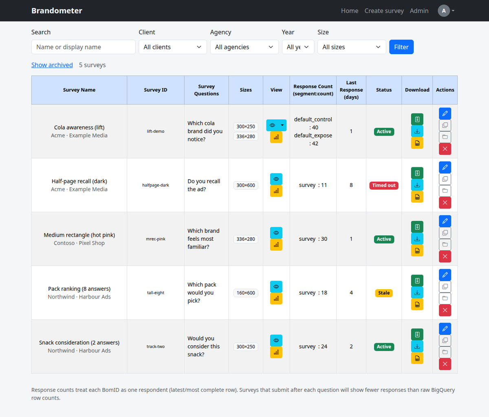

*Home (1400px, `xxl`): 20 seeded surveys, fluid list, Status + Result filters, two-line **Last Rcvd** header, Result badges, Progress %, one-line rows, no horizontal scrollbar.*

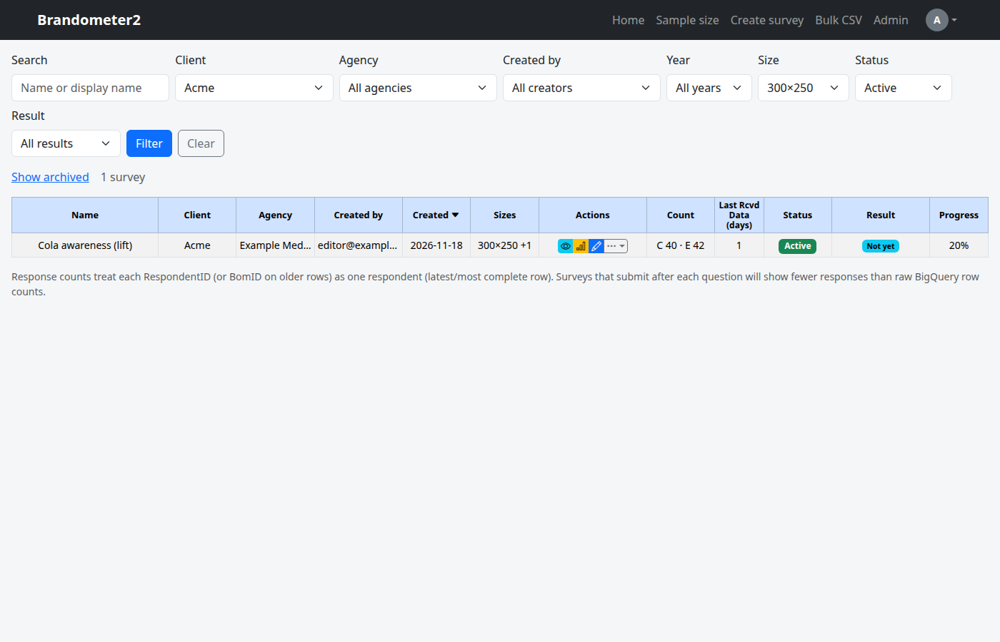

*Status filter set to **Active**, plus client **Acme** and size **300×250**. Matching Active Acme 300×250 rows from the 20-survey seed. Clear appears once a filter is set.*

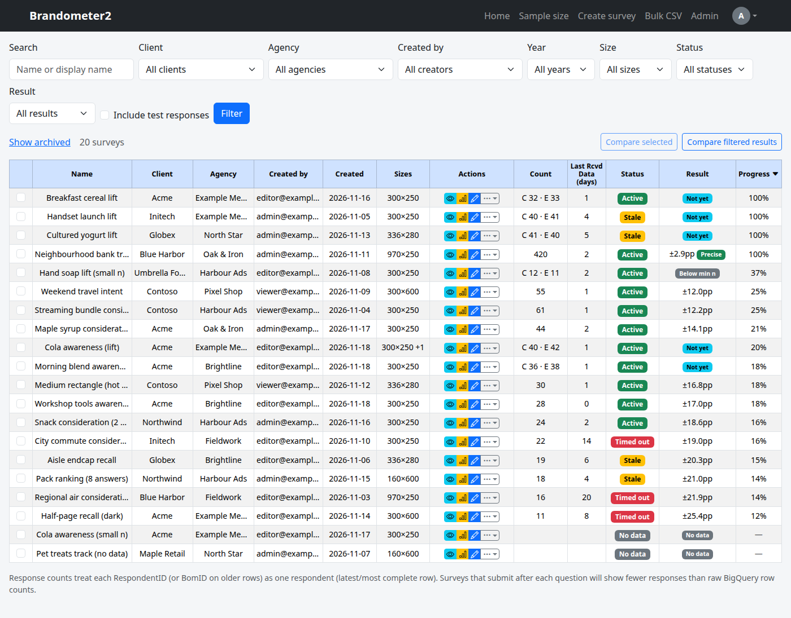

*Progress / Result (`sort=progress`): Brand Lift percent of the saved plan and sequential Result; Brand Track Wilson ±margin (Precise when the ±3pp target is met).*

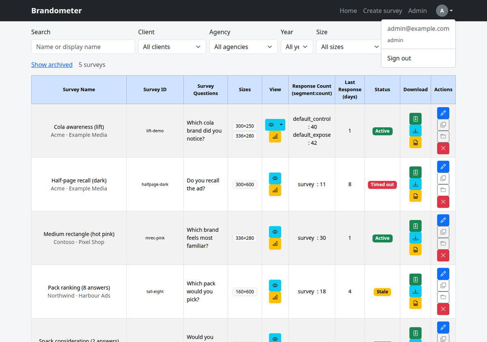

*Avatar menu: Google photo when the account has one, otherwise an initial. Dropdown shows email, role, and Sign out.*


*Narrow (800px / `md`): Name, Client, Created, Actions, Status, Result. Count / Last / Agency / Created by / Sizes / Progress hidden. Below 768px the list becomes cards.*

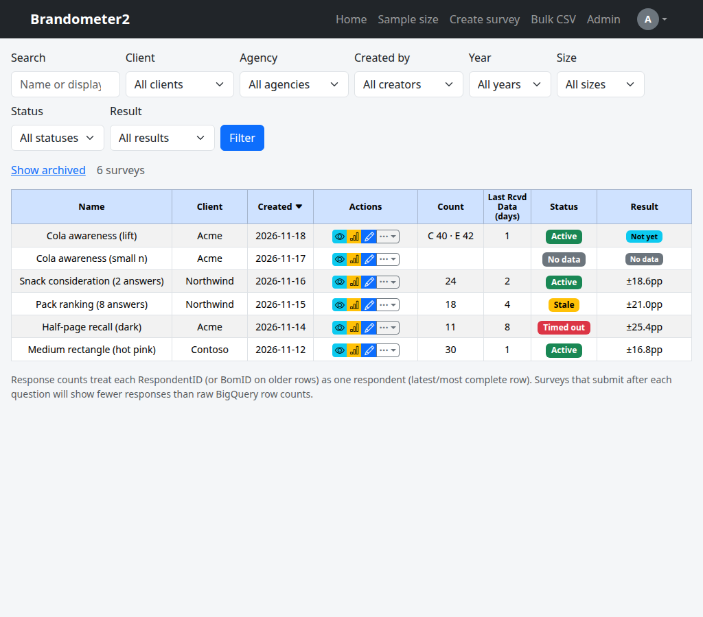

*Laptop (1024px / `lg`): Count and Last Rcvd join the always-on columns. Agency, Created by, Sizes, and Progress stay hidden so the table fits without a horizontal scrollbar.*

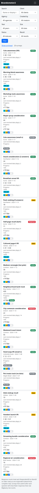

*Phone (390px): cards instead of the table. Each card shows name, client, created date, status, last received, progress, result, and actions.*


*Actions ⋯ menu: downloads for everyone; copy / archive / delete for editors. Delete still asks to confirm.*

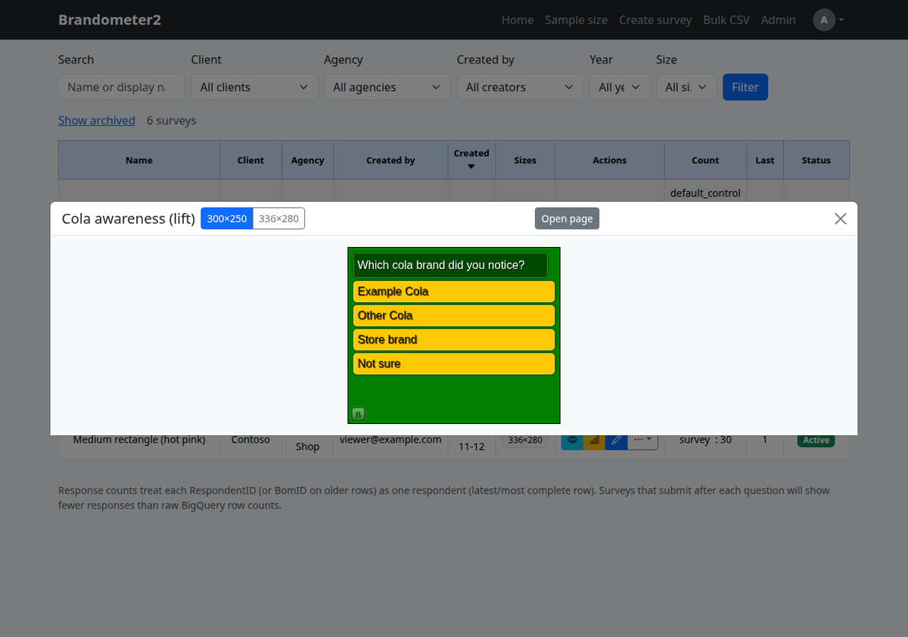

*Preview modal: iframe of `/survey/preview/<id>?embed=1`, size switcher in the header, **Open page** for the standalone preview.*

### Survey editor

Create or edit a survey in the browser (Bootstrap 5.3.3, Alpine.js, live iframe preview).

* **Sizes:** 300×250 (default for old surveys), 160×600, 300×600, 336×280, 970×250. You can select more than one. 970×250 lays answers in a wrapping grid. Not 728×90 / 320×50 / 320×100.
* **Answers:** 2–5 on 300×250 / 336×280 / 970×250; up to 8 (a–h) when **every** selected size is 160×600 or 300×600. Empty rows are skipped. Answer text wraps.
* **Themes:** grouped presets (Classic, Loud solids, Complementary, Patterns). Classic green is the default. Pickers write `--bv2-*` CSS variables (`--bv2-bg`, `--bv2-accent`, …) inside `BV2_THEME_START` / `BV2_THEME_END`. Each answer is its own bordered button with spacing (theme block + layout overlay), including when leftover default CSS is absent. Answer options, Next, Advertisement, and the disclosure badge use a pointer cursor; question/answer/button text is not selectable (`user-select: none`). The layout overlay applies this after the theme block so it survives BV2 theme CSS. Keyboard focus outlines stay visible. Free-form CSS stays under Advanced. Custom CSS written for the old names is not applied — re-pick a preset (or rewrite the variables) for new zips.
* **Disclosure badge:** bottom-left **B** / **B2** / **Ad** / **Name** pill on the creative. **Name** is an editable agency wordmark (prefilled from Agency, max 40 characters, HTML-escaped). Optional tooltip (max 120 characters).
* **Identity:** optional display name, client, agency, campaign ID, placement ID, and **ad server** (CM360 default, DV360, GAM, or generic). Display name is the homepage label; the survey name still drives zip filenames. Campaign/placement IDs show on the report, the tag sheet, response CSV (fallback when the pixel did not send them), and as pixel fallbacks when the ad-server macro does not expand.
* **Ad-server macros:** each zip sets `clickTag` and cachebuster / campaign / placement / site / creative / user-id / GDPR / US-privacy placeholders for the selected ad server. Expanded IDs are sent on the pixel (`camp`, `plc`, `site`, `crid`). Unexpanded placeholders are not sent. GDPR/US privacy strings stay in the creative for the ad environment; they are **not** stored in BigQuery. Generic mode keeps a static clickTag.
* **Tag sheet:** editors download CSV or XLSX listing each inner zip (size × Brand Lift segment), filenames, survey campaign/placement IDs, macros, the next zip snapshot version (`ver=`), and trafficking notes.
* **CM360 / DV360 bulk files:** one row per inner zip (`cm360_html5_bulk.csv`, `dv360_html5_bulk.csv`, plus `HOW_TO_UPLOAD.txt`). Advertiser ID is left blank for you to fill in the ad-server UI. No OAuth and no API client — fill the sheet and upload inner zips by hand. Also inside the outer ZIP.
* **Versions:** each creative ZIP download stores an immutable snapshot **first**, then bakes that number into the pixel as HMAC-bound `ver=`. The edit page can re-download an old version (same `ver=`). Editing the live survey does not change past snapshots. Old responses without `ver=` have NULL `CreativeVersion`.
* **HTML5 spec QA:** the editor lists IAB display / CM360 / DV360 checks for the current sizes (zip size, file count, clickTag, `ad.size` vs labelled size, no nested zip, no unexpected external requests). Warnings never block a download. The survey’s own response URL is an **info** note (required; some publishers need that domain allowlisted), not a warning. `navigator.sendBeacon` to that same receiver (unload retry) is also **info**. `fetch` / `XMLHttpRequest` stay warnings. Other `https://` URLs stay warnings. Each line has a **What does this mean?** control that expands plain-English help in place (Bootstrap collapse; no extra script). The outer zip includes `html5_qa.txt` (`[info]` vs `[warning]`). Help copy lives in `creative/app/ui_help.py`.
* **Bulk CSV:** editors can download a template, preview validation, and create up to 50 surveys at once (`/survey/bulk`). Invalid rows are listed and skipped. Default theme CSS is applied; change style in the editor afterwards.
* **Sample-size planner:** navbar **Sample size**, a calculator on each survey row, and a link from the editor and report. Estimates Brand Lift respondents and impressions from baseline rate, minimum detectable lift (relative % or absolute pp), 95%/80% defaults, Holm/Bonferroni-style comparisons, response rate, and control:exposed split. Server-side two-proportion z-test (same as the report) with a 30-per-arm floor. Viewers calculate; editors save the plan on the survey. Help copy is in `ui_help.py`.

Download from the homepage is an **outer ZIP** of one HTML5 inner zip per size (and per cell) plus `html5_qa.txt` and the CM360/DV360 bulk-upload CSVs. Unzip the outer file and upload each **inner** zip to CM360. Do not upload the outer zip, `html5_qa.txt`, or the sidecar CSVs as a creative. Inner zips contain only `index.html`.


*Editor (1400px): identity, multi-size checkboxes, cells (control / expose / holdout / other), HTML5 spec QA, Classic green theme, and live iframe preview with bordered answer buttons.*

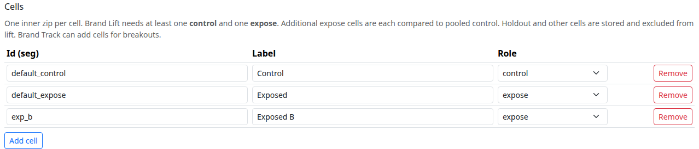

*Cells: one inner zip per cell. Brand Lift needs at least one control and one expose (defaults match today’s `default_control` / `default_expose`). Extra expose cells are each compared to pooled control. Holdout and other are stored and excluded from lift. Brand Track can add cells for breakouts.*

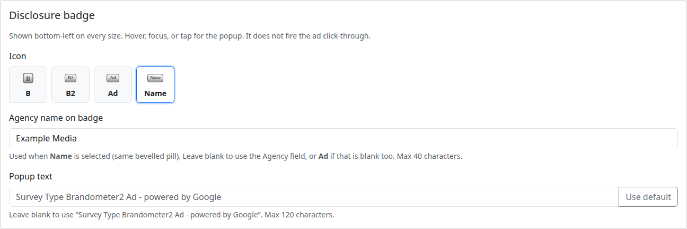

*Disclosure badge: **B** / **B2** / **Ad** / **Name**. **Name** uses the Agency name on badge field (prefilled from Agency, max 40 characters).*


*HTML5 spec QA: each finding has a **What does this mean?** toggle. The survey receiver URL is info; other external URLs are warnings.*

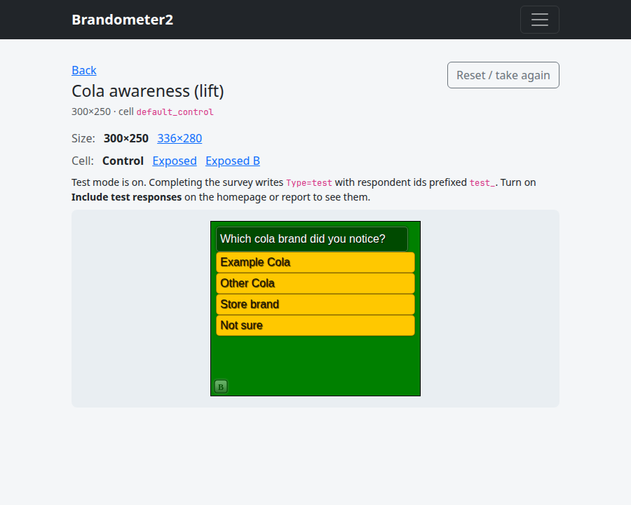

*Preview (`/survey/preview/<id>`): size links switch among the survey’s selected sizes; **Cell** switches the baked `seg` when the survey has cells. Editors can **Submit test response** on the standalone page (not the homepage modal): answers POST as `Type=test` with respondent ids prefixed `test_`. Reports, homepage counts, CSV, sequential stats, and Looker views exclude those rows unless you turn on **Include test data**. The **Thank You** end screen is flex-centered in the creative minus the 24px badge gutter (every size, including long copy and RTL). `<html lang>` / `dir` follow the survey language (`ar` / `he` / `fa` / `ur` are RTL). The measurement pixel is fire-and-forget and must not block that screen. Re-download HTML5 zips after layout or pixel changes.*

### Creatives

Natural-size captures of the `#master_container` from seeded sample surveys. Themes are CSS-only presets; answer counts are 2, 4, or 8.

<table>
  <tr>
    <td align="center" valign="top">
      <br>
      <em>300×250 · Classic · 4 answers</em>
    </td>
    <td align="center" valign="top">
      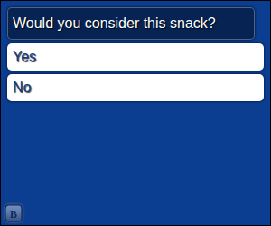<br>
      <em>300×250 · Ocean · 2 answers</em>
    </td>
  </tr>
  <tr>
    <td align="center" valign="top">
      <br>
      <em>336×280 · Hot pink · 4 answers</em>
    </td>
    <td align="center" valign="top">
      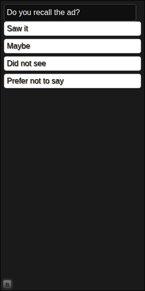<br>
      <em>300×600 · Dark · 4 answers</em>
    </td>
  </tr>
  <tr>
    <td align="center" valign="top">
      <br>
      <em>160×600 · Hazard · 8 answers</em>
    </td>
    <td align="center" valign="top">
      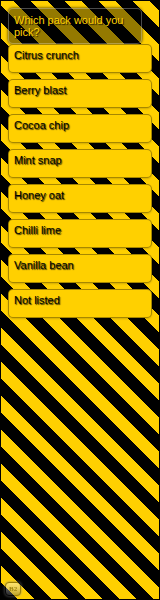<br>
      <em>160×600 · eight answers (tall-only)</em>
    </td>
  </tr>
</table>

### Reporting and CSV

The stats button works for **Brand Lift and Brand Track**.

* Counts, reports, and CSV treat each **respondent** as one person: `COALESCE(RespondentID, BomID)` (latest, most complete `Response`). New creatives send a durable `rid` (hashed ad-server user macro when the ad server expands it, otherwise `localStorage` / `sessionStorage` for this survey, otherwise a per-impression UUID). Existing rows without `RespondentID` still collapse by BomID. Surveys that submit after each question show fewer people than raw BigQuery row counts.
* Brand Lift: control vs exposed, Wilson 95% CIs (not Wald), two-proportion z-test, Holm–Bonferroni p-adj (overall table; each breakout dimension is its own family), warning when an arm or question has fewer than 30 respondents. **Sequential status** (Collecting / conclusive positive or negative lift / futility / n&lt;30) uses an O’Brien–Fleming (Lan–DeMets) boundary against the saved sample plan, or an always-valid bound when there is no plan. Safe to peek anytime; fixed-horizon p-values and CIs are only valid at the planned end. Breakouts stay fixed-horizon. **What does this mean?** explains those terms (same `ui_help.py` module). Segments come from the stored `seg` value (`control` / `expos` in the string). Unadjusted breakout p-values are exploratory.
* Brand Track: answer distributions and responses per day.
* **Breakouts:** the report page slices the same lift / Wilson CIs / z-test by **size**, **placement**, **site**, **ad-server creative ID**, **zip snapshot version**, **date**, and **segment**. Dimensions that are blank on every row are omitted. Rows without `ver=` show as **Unknown / pre-version**. Download **Breakouts CSV** from the report or the homepage. Response CSV includes Size and Creative version.
* Three response CSVs: responses, responses with question text (both stream), and breakouts (one table of overall + slices).
* **Looker Studio / BigQuery analysts:** `./deploy` (including `--app-only`) creates dataset `brandometer_reporting` with authorized views `deduped_responses` (one row per respondent) and `survey_summaries`. Grant `READER` on that dataset only — not on `responses`. The report page **Open in Looker Studio** uses the [Looker Studio Linking API](https://developers.google.com/looker-studio/integrate/linking-api) at `lookerstudio.google.com/reporting/create`. With no template it uses the **alias-less** default-report form (`ds.connector=bigQuery`, not `ds.ds0`, which is only valid on a template that already has that alias). Each click starts a new report whose data source is a `CUSTOM_QUERY` on `deduped_responses` filtered to that survey (`WHERE survey_id = …`); the Linking API cannot pass a chart filter on TABLE params. Optional env `LOOKER_TEMPLATE_REPORT_ID` (and `LOOKER_TEMPLATE_DS_ALIAS`) copy a saved template via `c.reportId`. Granting a user or group is documented in DEVELOPERS.md.

Preview **does not** post to BigQuery. To generate test rows, curl the receiver (see DEVELOPERS.md).


*Brand Lift report (1400px): **Open in Looker Studio**, sequential status, daily chart, answer distribution, Wilson 95% CIs, lift, p-value, and Holm–Bonferroni p-adj.*

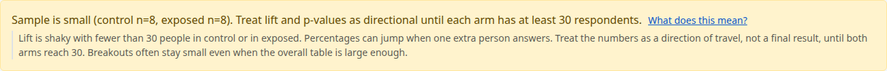

*Small-n warning (n &lt; 30 in an arm): expand **What does this mean?** for when to treat lift as directional only.*


*Sample-size planner: baseline, MDE, confidence/power, comparisons, response rate, and split. Outputs responses and estimated survey impressions. Editors can save the plan on a survey.*

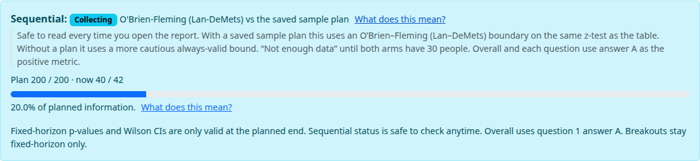

*Sequential status on the Brand Lift report: progress toward the saved plan, and a bound that is safe to check before the planned end.*

### Admin, sign-in, and viewer 403


*Admin: per-email roles (admin / editor / viewer), allowed domains with a default role, and the audit log. Example emails only.*

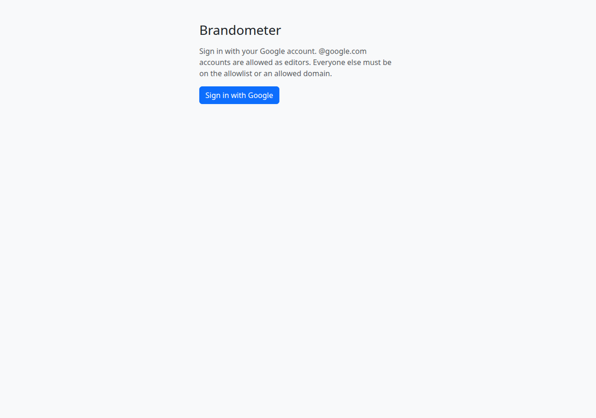

*Sign-in: Google OIDC. @google.com accounts are allowed as editors; everyone else must be on the allowlist or an allowed domain.*


*Viewer hitting `/admin`: friendly 403. Creating, editing, copying, archiving, deleting, ZIP download, and Admin are blocked server-side, not only hidden in the UI.*

### Trafficking (CM360 / DV360)

Brand Lift **control and expose are copies of the same survey creative** (same questions, size, and style). The only difference is a baked `seg` per cell sent on the pixel. Defaults are `default_control` / `default_expose`. Serve each control zip to a **Control** audience (people **not** exposed to the campaign) and each expose zip to an **Expose** audience (people who **were** exposed). Reporting uses the survey’s stored cells (`id` → `role`); surveys without cells still classify from `control` / `expos` in the stored `seg`. The app does **not** generate or require a PSA, house ad, pre-survey, master, or brand-neutral fallback creative.

1. Download the outer ZIP, unzip it, and upload each **inner** HTML5 zip in CM360 (not the outer file, not `html5_qa.txt`, not the bulk CSVs). Match each placement’s dimensions to a selected survey size. Review `html5_qa.txt` before trafficking; warnings never block the download. Optional: fill Advertiser ID on `cm360_html5_bulk.csv` / `dv360_html5_bulk.csv` and use those sheets in the ad-server bulk UI (`HOW_TO_UPLOAD.txt`). There is no CM360/DV360 API in this app.
2. Brand Lift: **one inner zip per size × cell**. Assign each control cell zip to the Control ad/audience and each expose cell zip to its Expose ad/audience. Overall sequential status and Result pool every control cell against every expose cell. Extra expose cells are each compared to pooled control (Holm across those cell tests). Holdout and other cells are excluded from lift.
3. Brand Track: **one inner zip per size** unless you add cells for breakouts (then one zip per cell).
4. Extra CM360 placements or DV360 line items are only needed if you want **placement- or site-level breakouts** or a later **cost/impressions join**. Expanded macros (`plc`, `site`, `crid`, `camp`) are stored on the response when the ad server fills them.

## Security and access

Production is **Google Sign-In** (OIDC via Authlib). Identity-Aware Proxy is not used. Shared Basic Auth is retired. There is **no tenancy**: every allowed user sees every survey.

The table is what changed versus upstream Brandometer. Detail follows.

| Risk (old) | Fix (this version) | Where it is enforced |
| --- | --- | --- |
| One shared HTTP Basic password; anyone with it is a full admin | Google Sign-In (OIDC). Session holds `user_email` / `user_role`. Navbar avatar + Sign out | `creative/app/google_auth.py`, `/login`, `/auth/callback` |
| No allowlist; no roles | Admin allowlist (email → role), allowed domains (default role), **admin / editor / viewer**. Server-side 403, not only hidden buttons | `creative/app/access.py`, `google_auth.require_editor` / `require_admin`, `templates/403.html` |
| @google.com not special-cased | Verified `@google.com` Google accounts can always sign in as **editor** unless listed with another role | `access.resolve_role` (`email_verified` + `hd`) |
| First deploy has no admin | `BOOTSTRAP_ADMIN_EMAIL` is always admin on first sign-in | `access.py`, `app.yaml` `BOOTSTRAP_ADMIN_EMAIL` (email, not a secret) |
| No audit trail | Firestore `AuditLog` for create / edit / delete / copy / archive and admin user/domain/role changes | `access.write_audit`, Admin page |
| Token / HMAC compares used `==` | Timing-safe `hmac.compare_digest` | `receiver/main.py` `token_is_valid`, `creative/app/receiver_crypto.py` |
| Delete / copy / archive were **GET** (csrf-able via ``) | **POST** + Flask-WTF CSRF. GET `/survey/delete` is 405 | `main.py` routes, `CSRFProtect(app)` |
| Last-write-wins on concurrent edits | Optimistic concurrency: save sends `expected_updated_at`; mismatch → **409** “Someone else saved this survey, reload” | `survey_collection.update`, `main.py` edit |
| Question / answer text assigned with `innerHTML`; `custom_css` could break out of `<style>` | Creative uses `textContent`. `sanitize_user_css` strips `</style`, `<`, `@import`, `url(javascript:` | `templates/creative.html`, `css_theme.sanitize_user_css` |
| Unsigned pixel URLs accepted | HMAC-SHA256(`RECEIVER_HMAC_SECRET`, survey id) as `token=`. When the zip stamps `ver=`, the HMAC is over `survey_id + newline + version` so `ver` cannot be spoofed. Old zips without `ver=` still use HMAC(survey id) only. **No unsigned fallback.** Default preview is unsigned and does not post; editor **Submit test response** is signed as `Type=test` | `receiver_crypto.py`, `receiver/main.py` (403 `invalid_token`) |
| Receiver accepted junk and returned 200 HTML | Regex validation; **204** empty body on success; 400 / 403 / 404 / 429 / 500 with a small JSON `reason` | `receiver/main.py` `validate_params`, `_pixel_response` |
| No abuse control on the public pixel | 30 req / min / (hashed IP + survey id), **per function instance**; 20 000 keys cap; `--max-instances=20` | `receiver/main.py` `allow_request` |
| Client IP stored (or unsalted SHA-256 of IP) | IP is **not** stored. `RandomTimeStamp` is HMAC-SHA256 of the IP keyed by `HMAC(IP_HMAC_SECRET, YYYY-MM-DD UTC)`. Same IP, same UTC day → same hash; hashes do not link across days | `receiver.hash_ip`, `receiver_crypto.hash_ip` |
| One row per impression (BomID was in-memory UUID only) | Durable survey-scoped `RespondentID`: hashed expanded ad-server user macro, else partitioned storage, else per-impression UUID. Raw user ids never on the pixel URL or in BQ. Old rows keep BomID | `creative.html` `resolveRespondentId`, `receiver` `rid`/`rsrc`, `respondent.session_keys` |
| Secrets in `app.yaml` / env / deploy prompts echoed | Secret Manager only. App Engine loads at startup via the SM client (`secret_environment_variables` is not valid on standard). `./deploy` prints `stored N chars`, never the value | `app_security.load_secret`, `app.yaml.template`, `./deploy` |
| App Engine SA had `roles/editor` | Least privilege: GAE SA is datastore user, BQ **jobUser** + dataset **WRITER**, secret accessor. Receiver SA is **datastore.viewer** only (plus BQ write + HMAC secrets). `roles/editor` is removed | `./deploy` |
| Analysts needed raw `responses` table access for Looker | Dataset `brandometer_reporting` with authorized views (deduped + per-survey summaries). Views are authorized on `responses`; analysts get `READER` on `brandometer_reporting` plus project `roles/bigquery.jobUser` | `./deploy` `ensure_reporting_dataset`, `bq_dataset_iam.py` `merge-reader` |
| Front-end from public CDNs | Self-hosted under `creative/app/static/vendor/` (Bootstrap 5.3.3, Bootstrap Icons 1.11.3, htmx 1.9.12, Alpine.js 3.14.3, Chart.js 4.4.6) | `static/vendor/`, tests fail if templates load jsDelivr / cdnjs / unpkg |
| Loose / un-audited Python deps | Pins in `creative/app/requirements.txt` and `receiver/requirements.txt`. `pip-audit` in `requirements-dev.txt` | See **pyarrow** note below |
| `DISABLE_BASIC_AUTH=1` could ship to App Engine and skip login | Refused when `GAE_ENV` is set. `app.yaml` check rejects the flag. Never written by `./deploy` | `app_security.apply_runtime_guards`, `app_yaml_check.py` |

### Roles

* **Admin** — Admin page plus everything editors can do.
* **Editor** — create, edit, copy, archive, delete, download creative ZIPs. No Admin page.
* **Viewer** — list, filters, preview, reports, and CSV. Cannot change surveys, download ZIPs, or open Admin.
* Missing / unknown stored roles read as **editor** so existing allowlist users are not downgraded.
* Domain default role applies only to people **not** already listed. Listing an email wins.

### Secrets

Created by `./deploy`. HMAC / `SECRET_KEY` are **not** rotated on later runs:

* `brandometer-oauth-client-id` / `brandometer-oauth-client-secret` — Google OAuth Web client
* `brandometer-secret-key` — Flask session signing
* `brandometer-receiver-hmac` — per-survey creative token
* `brandometer-ip-hmac` — daily IP-hash master

App Engine env vars are non-secret only: `PROJECT_ID`, `RECEIVER_URL`, `TABLE_ID`, `GTAG_ID`, `BOOTSTRAP_ADMIN_EMAIL`, optional `LOOKER_TEMPLATE_REPORT_ID` / `LOOKER_TEMPLATE_DS_ALIAS`.

Rotating `brandometer-receiver-hmac` invalidates every live zip until you re-download. Rotating `SECRET_KEY` signs everyone out.

### Dependency audit and pyarrow (PYSEC-2026-113)

`pip-audit -r creative/app/requirements.txt` and `pip-audit -r receiver/requirements.txt` (see DEVELOPERS.md). Pins include `protobuf==5.29.6` and, in tests, `pytest==9.0.3`.

**Accepted exception: [PYSEC-2026-113](https://osv.dev/vulnerability/PYSEC-2026-113) on `pyarrow==17.0.0`.** The pin stays because `google-cloud-bigquery-storage` is still listed; the app itself never opens a Storage read session (homepage, reports, and CSV all use jobs REST). We do not “fix” this finding by deleting the pin.

### Known limitations / remaining work

* **CSP allows inline script and `unsafe-eval`.** Alpine `x-data`, Chart.js bootstraps, and creative HTML (including editor `srcdoc` preview) are inline. A nonce/hash CSP is not shipped. `CSP_REPORT_ONLY=1` switches the header to report-only.
* **Homepage stats cache.** `/index/stats-partial` uses an in-process L1 plus a Firestore `StatsCache` L2 (`STATS_CACHE_SECONDS`, default 90). Logical `expires_at` only — no extra paid product. `STATS_SHARED_CACHE=0` disables L2. Brand Track ±margin target is `TRACK_TARGET_MOE` (default `0.03`; `3` means 3pp).
* **Receiver rate limit is per instance**, not global. `--max-instances=20` × 30/min is the theoretical ceiling for one IP+survey.
* **Durable IDs only survive as far as the ad environment allows.** Unexpanded `%u` / `${USER_ID}` placeholders, Safari/Chrome storage partitioning, and in-app preview (no pixel) all mean many impressions still look unique. Raw ad-server user IDs are never stored.
* **Phase 7d leftover** (not built): CM360 / DV360 cost/impressions join. Bulk-upload **files** (item 67) and the shared stats cache (item 68) are shipped; the CM360/DV360 APIs are not. Also not built: free-form write-in answers, in-stream video/VAST. See **Assessments (not built)** in [DEVELOPERS.md](DEVELOPERS.md).

## Architecture

| Piece | What it is |
| --- | --- |
| App | App Engine **standard python312**, Flask 3, instance class F4, `automatic_scaling.max_instances` (deploy env `MAX_INSTANCES`, default **5**) |
| Surveys | Firestore Native `(default)` — survey docs, versions, allowlist, audit log |
| Responses | BigQuery dataset `responses`, table `responses` (`$PROJECT_ID.responses.responses`). Authorized views in `$PROJECT_ID.brandometer_reporting` (`deduped_responses`, `survey_summaries`) |
| Pixel | Gen2 Cloud Function `receiver` (python312, HTTP, unauthenticated, dedicated SA, `--max-instances=20`) |
| UI assets | `/static` on App Engine; `/favicon.ico` is a static file |

## Setup and deploy

Prerequisites: [Google Cloud SDK](https://cloud.google.com/sdk/) (`gcloud` and `bq`), Python 3.12, pip, a GCP project with billing enabled.

### OAuth client

1. In the Cloud Console, open the project.
2. **APIs & Services → OAuth consent screen.** Use **Internal** for a Google Workspace project; otherwise **External** and add yourself as a test user while the app is in Testing. App name `Brandometer2`. Scopes: `openid`, userinfo email, userinfo profile. Authorized domain: `appspot.com`.
3. **Credentials → Create credentials → OAuth client ID → Web application.**

Authorized JavaScript origins (replace `PROJECT_ID`; us-central App Engine also uses `uc.r.appspot.com`):

* `https://PROJECT_ID.appspot.com`
* `https://PROJECT_ID.uc.r.appspot.com`
* `http://127.0.0.1:8080`
* `http://localhost:8080`

Authorized redirect URIs (exact):

* `https://PROJECT_ID.appspot.com/auth/callback`
* `https://PROJECT_ID.uc.r.appspot.com/auth/callback`
* `http://127.0.0.1:8080/auth/callback`
* `http://localhost:8080/auth/callback`

Copy the client ID and secret. You will paste them into `./deploy` (or set env vars). Do not commit them.

### Deploy

```shell
gcloud auth login
gcloud config set project "$PROJECT_ID"
./deploy "$PROJECT_ID" us-central1 us-central
```

Arguments are **project**, **Functions / BigQuery / Firestore location** (`gcloud functions regions list`), **App Engine region** (`gcloud app regions list`). Example: `us-central1` then `us-central`.

The script prompts for OAuth client id, OAuth client secret, and bootstrap admin email. **Enter keeps an existing secret.** After a write it prints `stored N chars` and never echoes the value.

App Engine only (receiver already up, or you are rotating the OAuth client secret):

```shell
./deploy "$PROJECT_ID" us-central1 us-central --app-only
```

Non-interactive (omit an env var to keep the existing secret):

```shell
OAUTH_CLIENT_ID='....apps.googleusercontent.com' \
OAUTH_CLIENT_SECRET='...' \
BOOTSTRAP_ADMIN_EMAIL='you@example.com' \
  ./deploy "$PROJECT_ID" us-central1 us-central --app-only --skip-oauth-prompts
```

`MAX_INSTANCES` (default 5) caps App Engine instances.

**HMAC secrets and `SECRET_KEY` are created once and never rotated by `./deploy`.** Rotating `brandometer-receiver-hmac` would invalidate every live creative zip. Rotating `SECRET_KEY` would sign everyone out.

**To rotate the OAuth client secret:** create a new secret on the OAuth client (or a new Web client), then rerun `./deploy … --app-only` and paste the new id/secret when prompted (or set `OAUTH_CLIENT_ID` / `OAUTH_CLIENT_SECRET`). Enter / `--skip-oauth-prompts` keeps the old values.

If a new project is still provisioning, wait a few minutes and rerun. `--app-only` is enough for App Engine code, yaml, favicon, and most IAM/dataset fixes; redeploy the receiver as well when its Python or HMAC wiring changes (see DEVELOPERS.md). Re-running `./deploy` (including `--app-only`) also runs `bq update --description` on the `responses` and `brandometer_reporting` datasets (and the `responses.responses` table) so existing projects pick up the Brandometer2 descriptions without recreating data.

## Local development

From the repo root:

```shell
python3.12 -m venv .venv
source .venv/bin/activate
pip install -r creative/app/requirements.txt
export PROJECT_ID="your-gcp-project-id"
export TABLE_ID="$PROJECT_ID.responses.responses"
export DISABLE_BASIC_AUTH=1
cd creative/app
flask --app main run --port 8080 --debug
```

Open http://127.0.0.1:8080. `python main.py` also works (`PORT` defaults to 8080). Cloud Shell Web Preview only proxies **8080**.

`DISABLE_BASIC_AUTH=1` is a local-dev bypass (full admin, `local-dev` in the navbar). The app **refuses to start** with that flag when `GAE_ENV` is set. Never put it in `app.yaml` or `./deploy`.

Listing and saving surveys need Application Default Credentials (`gcloud auth application-default login`). Preview works without the receiver. Signed zip tokens need `RECEIVER_HMAC_SECRET`. Optional Google Sign-In locally: put `http://127.0.0.1:8080/auth/callback` on the OAuth client.

### Tests

GCP is not required:

```shell
pip install -r creative/app/requirements.txt -r requirements-dev.txt
cd creative/app
PYTHONPATH=. python -m pytest
```

### Backfill created_at / created_by

Old survey docs may lack those fields (they show as **Unknown**). From Cloud Shell on project `brandometer2`:

```shell
python3 tools/backfill_created.py --project brandometer2
python3 tools/backfill_created.py --project brandometer2 --apply
```

Dry-run prints the patches. `--apply` writes only missing values from `AuditLog` create/copy rows. AuditLog starts 2026-11-19; older surveys likely stay Unknown. See DEVELOPERS.md.

### Demo data (Firestore + BigQuery)

`tools/seed_demo_data.py` loads a fictional agency-world homepage dataset into the **live** project (`brandometer2`) so you can page the list (default **220** surveys, `HOMEPAGE_PAGE_SIZE` 50 → 4+ pages). **Dry-run is the default.** This environment must not run `--apply` / `--purge --apply`; Mark runs those in Cloud Shell.

Each fictional client has a consistent brand palette written as a `BV2_THEME` block (`--bv2-bg`, text, button, accent, font, optional pattern) with campaign-to-campaign variation (Harbor Grocer greens, Voltway Motors electric blue, Neon Circuit Games neon/dark, and so on). Combinations meet WCAG AA. The homepage list does not paint those colours; open **Preview** after seeding to see them. Demo surveys also set `badge_name` to the fictional agency (and rotate **B** / **B2** / **Name** icons). No App Engine deploy is required for theme or badge-name updates — re-run `--apply`.

**Warning: `--apply` writes to production Firestore and `brandometer2.responses.responses`.** `--purge --apply` deletes **only** tagged demo records.

```shell
# Cloud Shell, project brandometer2, from the repo root
gcloud config set project brandometer2
python3 tools/seed_demo_data.py --project brandometer2
python3 tools/seed_demo_data.py --project brandometer2 --apply
python3 tools/seed_demo_data.py --project brandometer2 --purge
python3 tools/seed_demo_data.py --project brandometer2 --purge --apply
```

Optional: `--seed 1` (reproducible, including themes), `--count 220` (must be ≥ 200). Re-running `--apply` replaces the tagged batch (deterministic ids `demo_<seed>_<nnnn>`), including `custom_css` themes; it does not duplicate.

Tags: Firestore `demo_seed: true` plus `demo_batch`, ids starting `demo_`; AuditLog `demo_audit_<id>`; BigQuery `ID` starts with `demo_` and `RandomTimeStamp` is `demo_seed:<batch>`; respondent ids `demo_<survey_id>_<seq>`. Rows load with a **load job** (NDJSON), not streaming inserts, so a later `DELETE` is not blocked by the streaming buffer. If anything was ever inserted with `insert_rows_json`, wait ~90 minutes before purge can remove those rows.

Your Cloud Shell user needs Datastore User on the project, BigQuery Job User, and BigQuery Data Editor on dataset `responses`. See DEVELOPERS.md.

### Screenshots

README images under `docs/images/` are captured from a local Flask process with **MockFirestore** and synthetic BigQuery rows. No GCP, no real client data, no real secrets.

```shell
pip install -r creative/app/requirements.txt -r tools/requirements-screenshots.txt
python3 -m playwright install chromium
python3 tools/capture_screenshots.py
```

The script sets `DISABLE_BASIC_AUTH=1`, `APP_BRAND_NAME=Brandometer2`, and dummy OAuth / HMAC values so Secret Manager is never called. Output is optimised PNG (desktop UI at 1400px wide; creatives stay natural size). Navbar, login, and titles in these shots show **Brandometer2**. The Brand Lift report shot is the viewport (breakout tables continue below). Homepage recapture includes `home.png`, `home-filters.png` (Status filter), `home-progress.png` (Progress/Result sort), `avatar-dropdown.png`, `home-actions-menu.png`, and `home-preview-modal.png` at 1400px, plus `home-narrow.png` (800px table), `home-1024.png` (1024px laptop, no horizontal scrollbar), and `home-cards.png` (390px cards). Other desktop UI shots are 1400px wide (report, editor, planner, admin, login, viewer 403). Creatives stay natural size.

## Querying results in BigQuery

Table: `` `$PROJECT_ID.responses.responses` `` (dataset `responses`, table `responses`). Columns (REQUIRED unless noted):

| Column | Type | Meaning |
| --- | --- | --- |
| `CreatedAt` | DATETIME | Insert time (DAY partition field on new tables) |
| `Type` | STRING | `survey` for live pixels; `test` for editor preview submissions (excluded from stats unless Include test data) |
| `ID` | STRING | Firestore survey id |
| `Segmentation` | STRING | Stored `seg` (Brand Lift control/expose; often empty for Track) |
| `Response` | STRING | Tokenised answers, e.g. `1:A\|2:B` |
| `Visual` | STRING | Unused placeholder (schema is REQUIRED) |
| `CreativeSize` | STRING | e.g. `300x250` |
| `RandomTimeStamp` | STRING | Daily HMAC of the client IP (not the IP, not unsalted SHA-256) |
| `BomID` | STRING | Session / impression grouping id from the creative (REQUIRED). New creatives set this to the same durable id as `RespondentID`. |
| `RespondentID` | STRING | Durable respondent id (NULLABLE). Missing on rows collected before Phase 7c. |
| `RespondentIDSource` | STRING | `macro`, `storage`, `impression`, or `bomid` (NULLABLE) |
| `CampaignID` | STRING | Expanded campaign macro or survey fallback (NULLABLE) |
| `PlacementID` | STRING | Expanded placement macro or survey fallback (NULLABLE) |
| `SiteID` | STRING | Expanded site macro (NULLABLE) |
| `AdCreativeID` | STRING | Expanded creative macro (NULLABLE) |

The app consolidates by `COALESCE(RespondentID, BomID)`. A raw count of rows can be higher than homepage / report / CSV counts.

```sql
SELECT
  ID,
  BomID,
  RespondentID,
  RespondentIDSource,
  Segmentation,
  Response,
  CreativeSize,
  CreatedAt
FROM `PROJECT_ID.responses.responses`
WHERE ID = 'SURVEY_ID'
ORDER BY CreatedAt;
```

Replace `PROJECT_ID` and `SURVEY_ID`. New deploys create `responses.responses` **DAY-partitioned on `CreatedAt`**, clustered by `ID`. Add a `CreatedAt` date filter so queries prune partitions. Homepage stats already use `STATS_LOOKBACK_DAYS` (default 400). If the live table is still unpartitioned, `./deploy` prints instructions and does not rewrite it — migrate with:

```shell
python3 tools/migrate_responses_partition.py --project brandometer2
python3 tools/migrate_responses_partition.py --project brandometer2 --apply
```

Dry-run is the default. `--apply` copies into a partitioned table, swaps names, and keeps `responses_unpartitioned_backup_YYYYMMDD`.

Analysts with Looker / reporting-dataset access should query the authorized views instead of the raw table:

```sql
SELECT *
FROM `PROJECT_ID.brandometer_reporting.deduped_responses`
WHERE survey_id = 'SURVEY_ID'
ORDER BY CreatedAt;
```

## Roadmap (not built)

Phase **7c** items **58**–**61** are shipped (durable respondent ID, ad-server macros + tag sheet, authorized views + Looker Studio, reporting breakouts). **7d** HTML5 spec QA (item 64), bulk CSV survey create (item 65), stats-method corrections (item 66), CM360/DV360 bulk-upload **files** (item 67; no API), and the shared Firestore stats cache (item 68) are shipped. Remaining **7d** — do not treat these as shipped:

* CM360 / DV360 cost/impressions join

Also not built: free-form write-in answers, in-stream video/VAST creatives, and a cost/impressions join. See **Assessments (not built)** in [DEVELOPERS.md](DEVELOPERS.md).

## License

Apache License 2.0. See [LICENSE](LICENSE).

This repository started as a copy of [google/brandometer](https://github.com/google/brandometer). Google is not a party to this fork and does not support it. Keep the Apache notices on files that still carry them.
