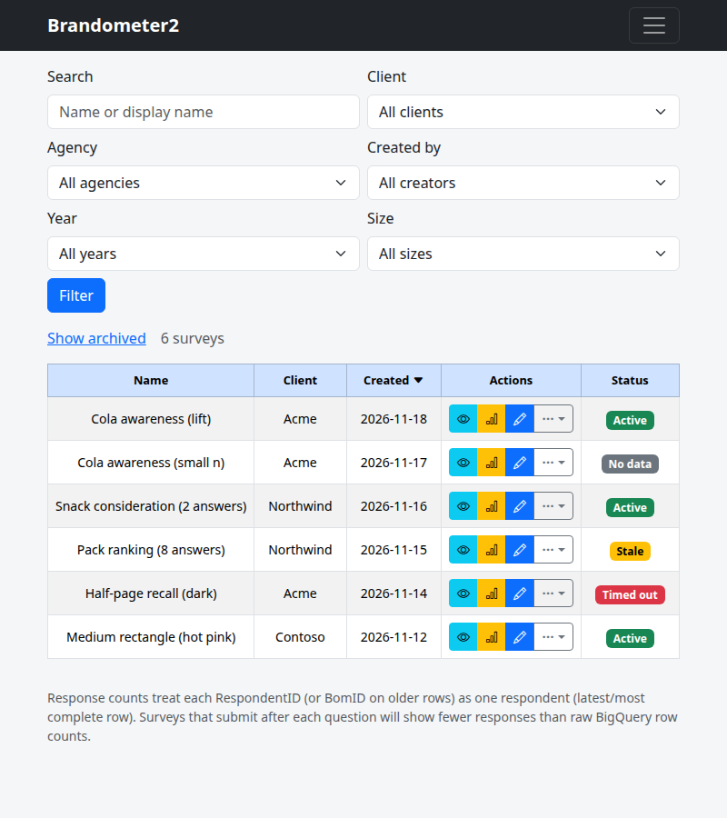
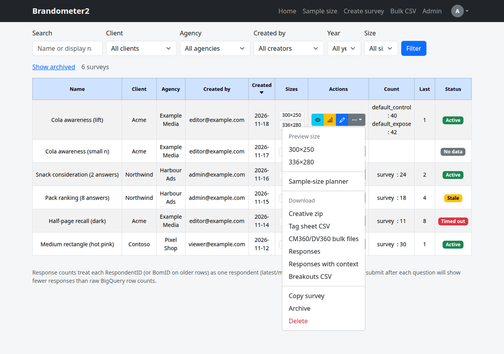
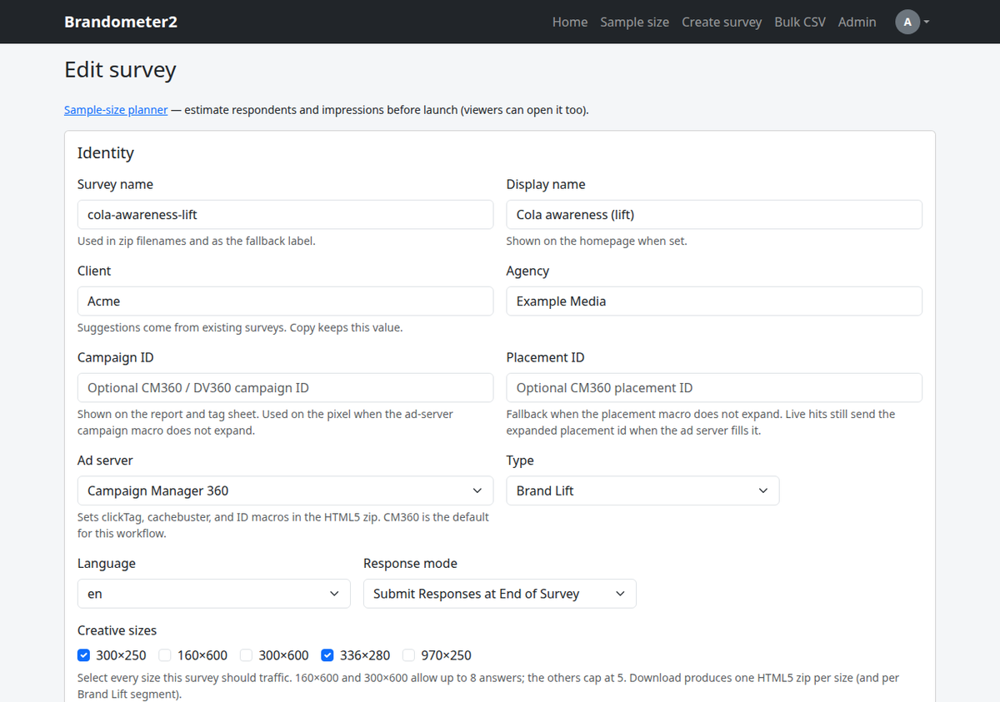
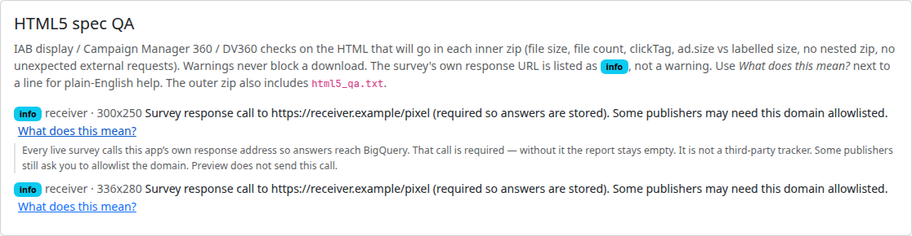
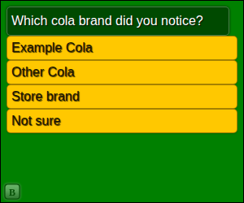
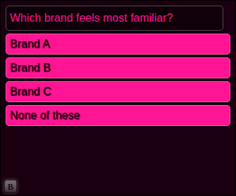
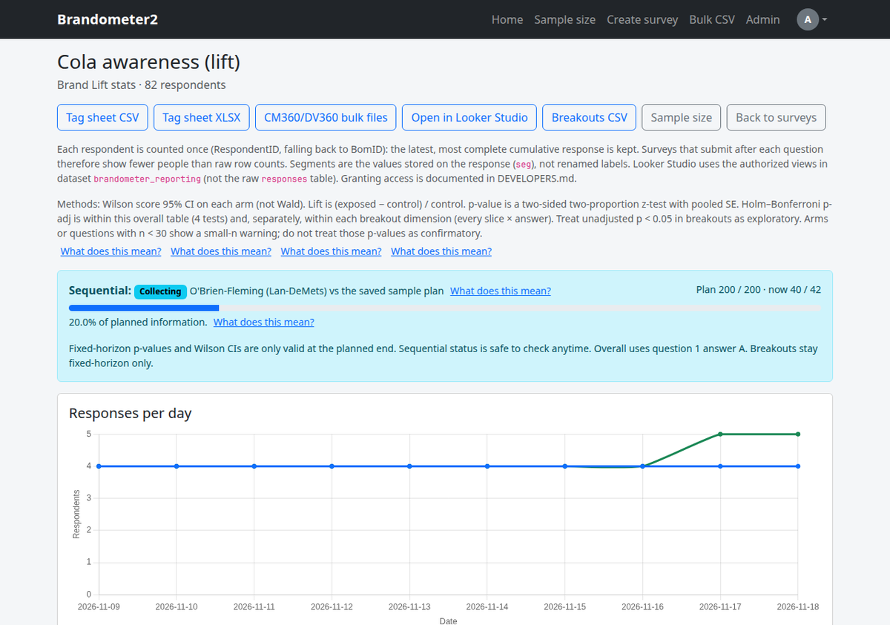
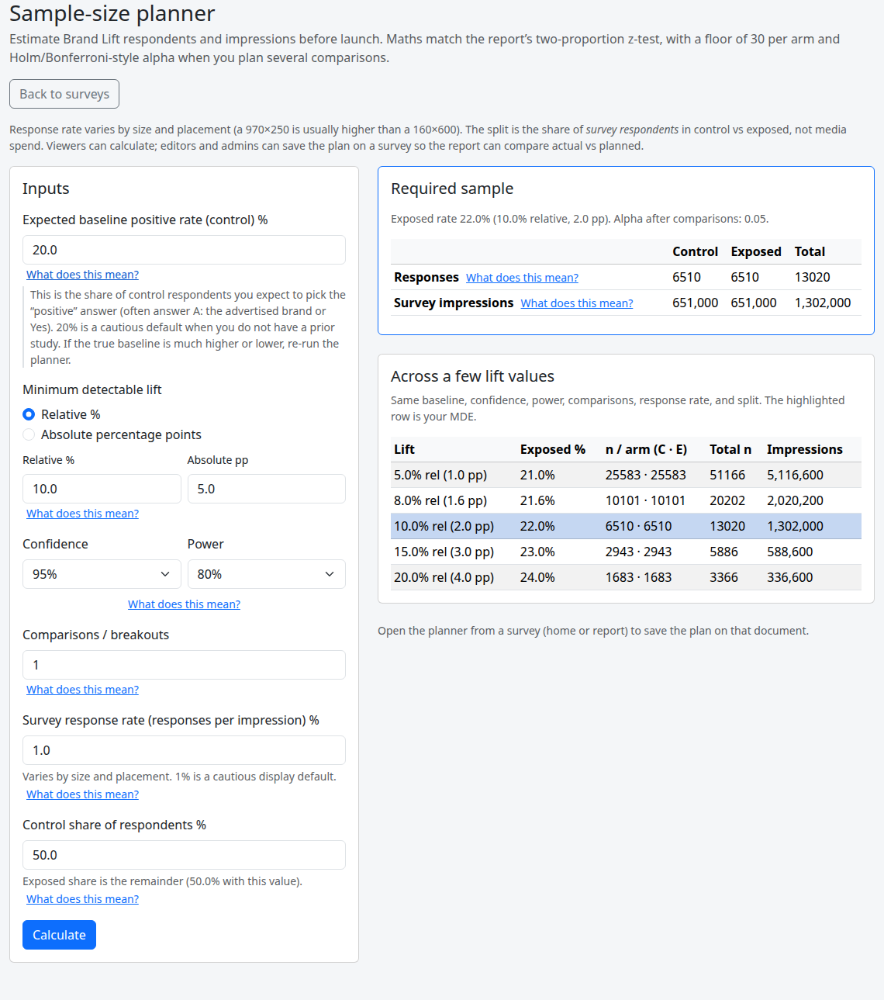
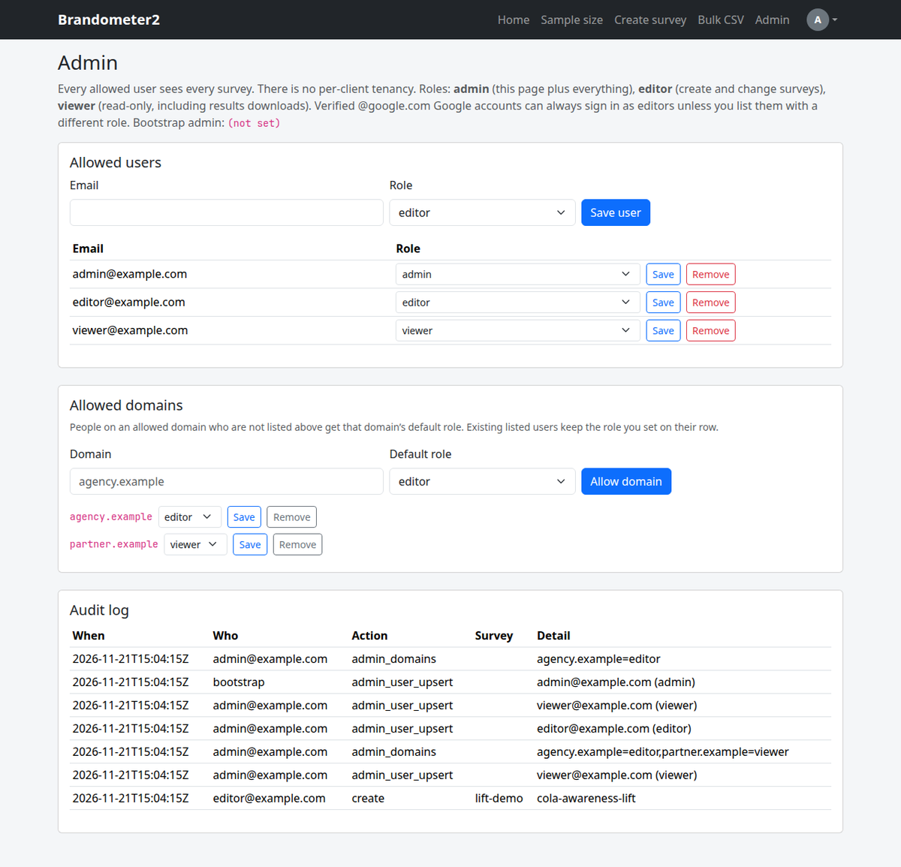
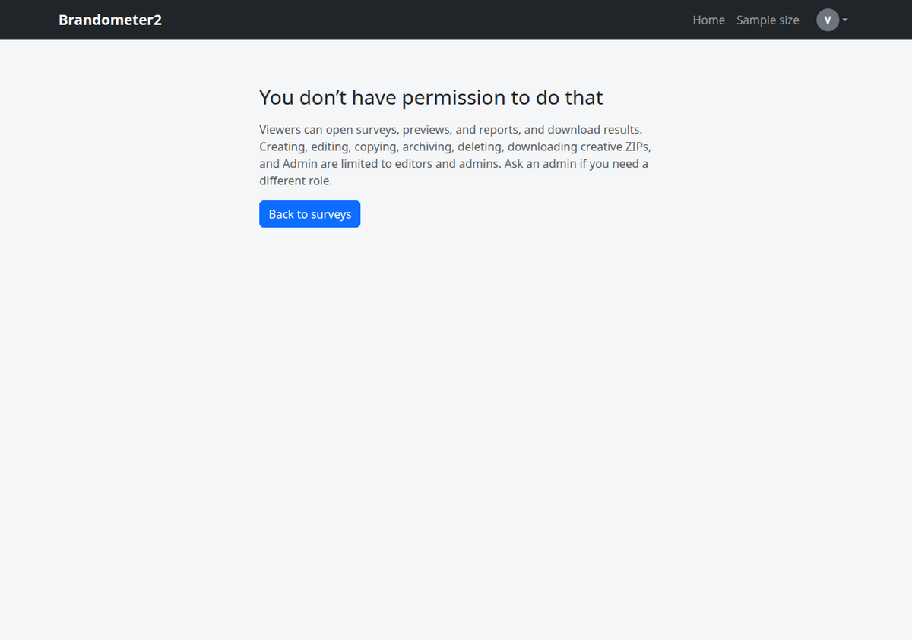

# Brandometer2

N.B. This is not an officially supported Google product.

Brandometer2 builds **brand-lift** and **brand-track** display surveys and hosts them on Google Cloud. Marketers create a survey in the app, download HTML5 zips, traffic them in Campaign Manager 360 / DV360, and read results in the app (or in BigQuery).

It is a fork of [Google Brandometer](https://github.com/google/brandometer) (Apache-2.0). The in-app product name is `APP_BRAND_NAME` (default **Brandometer2**). Navbar, page titles, login, and the disclosure-badge tooltip use it. Override with `export APP_BRAND_NAME=…`. Developer detail lives in [DEVELOPERS.md](DEVELOPERS.md).

Screenshots below use **seeded sample surveys** (Acme, Northwind, Contoso) and generic example emails. They are not production data. Regenerate them with `python3 tools/capture_screenshots.py` (see [Screenshots](#screenshots)).

**Docs stay in the same commit.** Every change in this repo must update this README in that same commit. Update [DEVELOPERS.md](DEVELOPERS.md) too when the change is operator- or developer-facing. See [AGENTS.md](AGENTS.md). Use only the Brandometer2 name; do not reference the previous fork's name in docs or UI.

## What’s new vs upstream

Upstream Brandometer was a Python 3.7 App Engine app with Basic Auth, a 300×250 creative, and spreadsheet reporting. Brandometer2 adds:

* A Bootstrap 5 survey editor (multi-size creatives, 2–8 answers, theme presets, wrapping text, disclosure badge, zip version history)
* Homepage archive/copy, status chips, and client/agency/year/size filters
* In-app reporting (Brand Lift with Wilson CIs, a z-test, Holm p-adj, and sequential early-stopping) and streamed CSV, with one row per respondent (`COALESCE(RespondentID, BomID)`)
* A sample-size planner (respondents and impressions) that editors can save on a survey
* Google Sign-In, an Admin page, and **admin / editor / viewer** roles (not IAP, not shared passwords)
* HMAC-signed pixel links, a survey-scoped durable respondent ID, daily-rotating IP hashes, CSRF on mutating actions, and a 409 when two people save the same survey
* Secret Manager, least-privilege service accounts, App Engine **python312**, a gen2 Cloud Function receiver, self-hosted front-end libraries, and an enforced Content-Security-Policy (avatars from `https://*.googleusercontent.com`; Google Sign-In endpoints; inline scripts for Alpine / Chart.js / creatives)
* A **Bv2** favicon and a Google-account avatar in the navbar

## Features

### Homepage

List with search plus **client / agency / created by / year / size** filters (kept on pagination and Show archived). Default order is **newest `created_at` first**; missing dates sort last. Click a column header to sort (name, client, agency, created by, created, id, sizes). Count / last response / status are not sortable. Page size 50. Client and Agency are their own columns (email in Created by). Old surveys without those fields show **Unknown**; `tools/backfill_created.py` can fill them from AuditLog.

* **Archive / unarchive** and **copy** (copy opens the new survey in the editor).
* Status chips: **Active** (≤ 3 days since last response), **Stale** (≤ 7 days), **Timed out** (after 7).
* One **Actions** column: Preview, Stats, and (editors) Edit as icon buttons; ZIP, tags, CSVs, copy, archive, and delete sit in a **⋯** menu. Viewers get Preview/Stats plus downloads in the menu, not mutate actions. Preview opens a modal (size switcher, `?embed=1` iframe); the standalone `/survey/preview/<id>` page is unchanged. Ctrl/Cmd-click still opens that page.
* **Responsive:** below 768px the list is cards (name, client, created date, status, actions). From `md` up the table shows; Agency hides until `xl`; Survey ID / questions hide until `xxl`; Created by / Sizes / Count / Last hide until `lg`. Client stays visible.
* Count / last-response / status cells load after the table (`/index/stats-partial`); the list itself does not wait on BigQuery. Empty per-survey count frames are dropped before `pandas.concat` (no FutureWarning on a page of surveys with no responses).
* Viewers see the list, filters, preview, reports, and CSVs (responses + breakouts). Create / edit / copy / archive / delete / ZIP / Admin are hidden and also **403** if requested.


*Home: seeded Brand Lift and Brand Track surveys, response counts, Active / Stale / Timed out chips, and editor actions.*


*Filters: client **Acme** and size **300×250**, with a Clear button once a filter is set.*


*Avatar menu: Google photo when the account has one, otherwise an initial. Dropdown shows email, role, and Sign out.*



*Narrow (800px): table still, Agency / Created by / Sizes / counts hidden. Below 768px the list becomes cards.*



*Actions ⋯ menu: downloads for everyone; copy / archive / delete for editors. Delete still asks to confirm.*


*Preview modal: iframe of `/survey/preview/<id>?embed=1`, size switcher in the header, **Open page** for the standalone preview.*

### Survey editor

Create or edit a survey in the browser (Bootstrap 5.3.3, Alpine.js, live iframe preview).

* **Sizes:** 300×250 (default for old surveys), 160×600, 300×600, 336×280, 970×250. You can select more than one. 970×250 lays answers in a wrapping grid. Not 728×90 / 320×50 / 320×100.
* **Answers:** 2–5 on 300×250 / 336×280 / 970×250; up to 8 (a–h) when **every** selected size is 160×600 or 300×600. Empty rows are skipped. Answer text wraps.
* **Themes:** grouped presets (Classic, Loud solids, Complementary, Patterns). Classic green is the default. Pickers write `--bv2-*` CSS variables (`--bv2-bg`, `--bv2-accent`, …) inside `BV2_THEME_START` / `BV2_THEME_END`. Free-form CSS stays under Advanced. Custom CSS written for the old names is not applied — re-pick a preset (or rewrite the variables) for new zips.
* **Disclosure badge:** bottom-left **B** / **B2** / **Ad** / **Dentsu** pill on the creative (not an official Dentsu logo). Optional tooltip (max 120 characters).
* **Identity:** optional display name, client, agency, campaign ID, placement ID, and **ad server** (CM360 default, DV360, GAM, or generic). Display name is the homepage label; the survey name still drives zip filenames. Campaign/placement IDs show on the report, the tag sheet, response CSV (fallback when the pixel did not send them), and as pixel fallbacks when the ad-server macro does not expand.
* **Ad-server macros:** each zip sets `clickTag` and cachebuster / campaign / placement / site / creative / user-id / GDPR / US-privacy placeholders for the selected ad server. Expanded IDs are sent on the pixel (`camp`, `plc`, `site`, `crid`). Unexpanded placeholders are not sent. GDPR/US privacy strings stay in the creative for the ad environment; they are **not** stored in BigQuery. Generic mode keeps a static clickTag.
* **Tag sheet:** editors download CSV or XLSX listing each inner zip (size × Brand Lift segment), filenames, survey campaign/placement IDs, macros, the next zip snapshot version (`ver=`), and trafficking notes.
* **CM360 / DV360 bulk files:** one row per inner zip (`cm360_html5_bulk.csv`, `dv360_html5_bulk.csv`, plus `HOW_TO_UPLOAD.txt`). Advertiser ID is left blank for you to fill in the ad-server UI. No OAuth and no API client — fill the sheet and upload inner zips by hand. Also inside the outer ZIP.
* **Versions:** each creative ZIP download stores an immutable snapshot **first**, then bakes that number into the pixel as HMAC-bound `ver=`. The edit page can re-download an old version (same `ver=`). Editing the live survey does not change past snapshots. Old responses without `ver=` have NULL `CreativeVersion`.
* **HTML5 spec QA:** the editor lists IAB display / CM360 / DV360 checks for the current sizes (zip size, file count, clickTag, `ad.size` vs labelled size, no nested zip, no unexpected external requests). Warnings never block a download. The survey’s own response URL is an **info** note (required; some publishers need that domain allowlisted), not a warning. Other `https://` URLs stay warnings. Each line has a **What does this mean?** control that expands plain-English help in place (Bootstrap collapse; no extra script). The outer zip includes `html5_qa.txt` (`[info]` vs `[warning]`). Help copy lives in `creative/app/ui_help.py`.
* **Bulk CSV:** editors can download a template, preview validation, and create up to 50 surveys at once (`/survey/bulk`). Invalid rows are listed and skipped. Default theme CSS is applied; change style in the editor afterwards.
* **Sample-size planner:** navbar **Sample size**, a calculator on each survey row, and a link from the editor and report. Estimates Brand Lift respondents and impressions from baseline rate, minimum detectable lift (relative % or absolute pp), 95%/80% defaults, Holm/Bonferroni-style comparisons, response rate, and control:exposed split. Server-side two-proportion z-test (same as the report) with a 30-per-arm floor. Viewers calculate; editors save the plan on the survey. Help copy is in `ui_help.py`.

Download from the homepage is an **outer ZIP** of one HTML5 inner zip per size (Brand Lift also splits Control and Expose) plus `html5_qa.txt` and the CM360/DV360 bulk-upload CSVs. Unzip the outer file and upload each **inner** zip to CM360. Do not upload the outer zip, `html5_qa.txt`, or the sidecar CSVs as a creative. Inner zips contain only `index.html`.



*Editor: identity, multi-size checkboxes, Classic green preset, and live iframe preview.*



*HTML5 spec QA: each finding has a **What does this mean?** toggle. The survey receiver URL is info; other external URLs are warnings.*


*Preview (`/survey/preview/<id>`): unsigned, does not post to BigQuery. Size links switch among the survey’s selected sizes. The **Thank You** end screen is local UI: it always appears after the last answer. The measurement pixel is fire-and-forget (skipped in preview because `receiver_url` is empty) and must not block that screen. Re-download HTML5 zips after this fix — copies trafficked before it can miss the end screen.*

### Creatives

Natural-size captures of the `#master_container` from seeded sample surveys. Themes are CSS-only presets; answer counts are 2, 4, or 8.

<table>
  <tr>
    <td align="center" valign="top">
      <br>
      <em>300×250 · Classic · 4 answers</em>
    </td>
    <td align="center" valign="top">
      <br>
      <em>300×250 · Ocean · 2 answers</em>
    </td>
  </tr>
  <tr>
    <td align="center" valign="top">
      <br>
      <em>336×280 · Hot pink · 4 answers</em>
    </td>
    <td align="center" valign="top">
      <br>
      <em>300×600 · Dark · 4 answers</em>
    </td>
  </tr>
  <tr>
    <td align="center" valign="top">
      <br>
      <em>160×600 · Hazard · 8 answers</em>
    </td>
    <td align="center" valign="top">
      <br>
      <em>160×600 · eight answers (tall-only)</em>
    </td>
  </tr>
</table>

### Reporting and CSV

The stats button works for **Brand Lift and Brand Track**.

* Counts, reports, and CSV treat each **respondent** as one person: `COALESCE(RespondentID, BomID)` (latest, most complete `Response`). New creatives send a durable `rid` (hashed ad-server user macro when the ad server expands it, otherwise `localStorage` / `sessionStorage` for this survey, otherwise a per-impression UUID). Existing rows without `RespondentID` still collapse by BomID. Surveys that submit after each question show fewer people than raw BigQuery row counts.
* Brand Lift: control vs exposed, Wilson 95% CIs (not Wald), two-proportion z-test, Holm–Bonferroni p-adj (overall table; each breakout dimension is its own family), warning when an arm or question has fewer than 30 respondents. **Sequential status** (Collecting / conclusive positive or negative lift / futility / n&lt;30) uses an O’Brien–Fleming (Lan–DeMets) boundary against the saved sample plan, or an always-valid bound when there is no plan. Safe to peek anytime; fixed-horizon p-values and CIs are only valid at the planned end. Breakouts stay fixed-horizon. **What does this mean?** explains those terms (same `ui_help.py` module). Segments come from the stored `seg` value (`control` / `expos` in the string). Unadjusted breakout p-values are exploratory.
* Brand Track: answer distributions and responses per day.
* **Breakouts:** the report page slices the same lift / Wilson CIs / z-test by **size**, **placement**, **site**, **ad-server creative ID**, **zip snapshot version**, **date**, and **segment**. Dimensions that are blank on every row are omitted. Rows without `ver=` show as **Unknown / pre-version**. Download **Breakouts CSV** from the report or the homepage. Response CSV includes Size and Creative version.
* Three response CSVs: responses, responses with question text (both stream), and breakouts (one table of overall + slices).
* **Looker Studio / BigQuery analysts:** `./deploy` creates dataset `brandometer_reporting` with authorized views `deduped_responses` (one row per respondent) and `survey_summaries`. Grant `READER` on that dataset only — not on `responses`. The report page has **Open in Looker Studio** (Looker Studio Linking API; each click starts a new report on the deduped view). Granting a user or group is documented in DEVELOPERS.md.

Preview **does not** post to BigQuery. To generate test rows, curl the receiver (see DEVELOPERS.md).



*Brand Lift report: responses per day, control vs exposed, Wilson 95% CIs under each arm %, lift, unadjusted p-value, and Holm–Bonferroni p-adj.*


*Small-n warning (n &lt; 30 in an arm): expand **What does this mean?** for when to treat lift as directional only.*



*Sample-size planner: baseline, MDE, confidence/power, comparisons, response rate, and split. Outputs responses and estimated survey impressions. Editors can save the plan on a survey.*


*Sequential status on the Brand Lift report: progress toward the saved plan, and a bound that is safe to check before the planned end.*

### Admin, sign-in, and viewer 403



*Admin: per-email roles (admin / editor / viewer), allowed domains with a default role, and the audit log. Example emails only.*


*Sign-in: Google OIDC. @google.com accounts are allowed as editors; everyone else must be on the allowlist or an allowed domain.*



*Viewer hitting `/admin`: friendly 403. Creating, editing, copying, archiving, deleting, ZIP download, and Admin are blocked server-side, not only hidden in the UI.*

### Trafficking (CM360 / DV360)

Brand Lift **control and expose are two copies of the same survey creative** (same questions, size, and style). The only difference is a baked `seg` (`default_control` vs `default_expose`) sent on the pixel. Serve the control zip to a **Control** audience (people **not** exposed to the campaign) and the expose zip to an **Expose** audience (people who **were** exposed). Reporting classifies rows from that stored `seg` (`control` / `expos` in the string), not from placement ID. The app does **not** generate or require a PSA, house ad, pre-survey, master, or brand-neutral fallback creative.

1. Download the outer ZIP, unzip it, and upload each **inner** HTML5 zip in CM360 (not the outer file, not `html5_qa.txt`, not the bulk CSVs). Match each placement’s dimensions to a selected survey size. Review `html5_qa.txt` before trafficking; warnings never block the download. Optional: fill Advertiser ID on `cm360_html5_bulk.csv` / `dv360_html5_bulk.csv` and use those sheets in the ad-server bulk UI (`HOW_TO_UPLOAD.txt`). There is no CM360/DV360 API in this app.
2. Brand Lift: **two inner zips per size**. Assign `…_default_control.zip` to the Control ad/audience and `…_default_expose.zip` to the Expose ad/audience. One placement per size with those two ads is enough for overall lift.
3. Brand Track: **one inner zip per size** (no control/expose split).
4. Extra CM360 placements or DV360 line items are only needed if you want **placement- or site-level breakouts** or a later **cost/impressions join**. Expanded macros (`plc`, `site`, `crid`, `camp`) are stored on the response when the ad server fills them.

## Security and access

Production is **Google Sign-In** (OIDC via Authlib). Identity-Aware Proxy is not used. Shared Basic Auth is retired. There is **no tenancy**: every allowed user sees every survey.

The table is what changed versus upstream Brandometer. Detail follows.

| Risk (old) | Fix (this version) | Where it is enforced |
| --- | --- | --- |
| One shared HTTP Basic password; anyone with it is a full admin | Google Sign-In (OIDC). Session holds `user_email` / `user_role`. Navbar avatar + Sign out | `creative/app/google_auth.py`, `/login`, `/auth/callback` |
| No allowlist; no roles | Admin allowlist (email → role), allowed domains (default role), **admin / editor / viewer**. Server-side 403, not only hidden buttons | `creative/app/access.py`, `google_auth.require_editor` / `require_admin`, `templates/403.html` |
| @google.com not special-cased | Verified `@google.com` Google accounts can always sign in as **editor** unless listed with another role | `access.resolve_role` (`email_verified` + `hd`) |
| First deploy has no admin | `BOOTSTRAP_ADMIN_EMAIL` is always admin on first sign-in | `access.py`, `app.yaml` `BOOTSTRAP_ADMIN_EMAIL` (email, not a secret) |
| No audit trail | Firestore `AuditLog` for create / edit / delete / copy / archive and admin user/domain/role changes | `access.write_audit`, Admin page |
| Token / HMAC compares used `==` | Timing-safe `hmac.compare_digest` | `receiver/main.py` `token_is_valid`, `creative/app/receiver_crypto.py` |
| Delete / copy / archive were **GET** (csrf-able via ``) | **POST** + Flask-WTF CSRF. GET `/survey/delete` is 405 | `main.py` routes, `CSRFProtect(app)` |
| Last-write-wins on concurrent edits | Optimistic concurrency: save sends `expected_updated_at`; mismatch → **409** “Someone else saved this survey, reload” | `survey_collection.update`, `main.py` edit |
| Question / answer text assigned with `innerHTML`; `custom_css` could break out of `<style>` | Creative uses `textContent`. `sanitize_user_css` strips `</style`, `<`, `@import`, `url(javascript:` | `templates/creative.html`, `css_theme.sanitize_user_css` |
| Unsigned pixel URLs accepted | HMAC-SHA256(`RECEIVER_HMAC_SECRET`, survey id) as `token=`. When the zip stamps `ver=`, the HMAC is over `survey_id + newline + version` so `ver` cannot be spoofed. Old zips without `ver=` still use HMAC(survey id) only. **No unsigned fallback.** Preview is unsigned and does not post | `receiver_crypto.py`, `receiver/main.py` (403 `invalid_token`) |
| Receiver accepted junk and returned 200 HTML | Regex validation; **204** empty body on success; 400 / 403 / 404 / 429 / 500 with a small JSON `reason` | `receiver/main.py` `validate_params`, `_pixel_response` |
| No abuse control on the public pixel | 30 req / min / (hashed IP + survey id), **per function instance**; 20 000 keys cap; `--max-instances=20` | `receiver/main.py` `allow_request` |
| Client IP stored (or unsalted SHA-256 of IP) | IP is **not** stored. `RandomTimeStamp` is HMAC-SHA256 of the IP keyed by `HMAC(IP_HMAC_SECRET, YYYY-MM-DD UTC)`. Same IP, same UTC day → same hash; hashes do not link across days | `receiver.hash_ip`, `receiver_crypto.hash_ip` |
| One row per impression (BomID was in-memory UUID only) | Durable survey-scoped `RespondentID`: hashed expanded ad-server user macro, else partitioned storage, else per-impression UUID. Raw user ids never on the pixel URL or in BQ. Old rows keep BomID | `creative.html` `resolveRespondentId`, `receiver` `rid`/`rsrc`, `respondent.session_keys` |
| Secrets in `app.yaml` / env / deploy prompts echoed | Secret Manager only. App Engine loads at startup via the SM client (`secret_environment_variables` is not valid on standard). `./deploy` prints `stored N chars`, never the value | `app_security.load_secret`, `app.yaml.template`, `./deploy` |
| App Engine SA had `roles/editor` | Least privilege: GAE SA is datastore user, BQ **jobUser** + dataset **WRITER**, secret accessor. Receiver SA is **datastore.viewer** only (plus BQ write + HMAC secrets). `roles/editor` is removed | `./deploy` |
| Analysts needed raw `responses` table access for Looker | Dataset `brandometer_reporting` with authorized views (deduped + per-survey summaries). Views are authorized on `responses`; analysts get `READER` on `brandometer_reporting` plus project `roles/bigquery.jobUser` | `./deploy` `ensure_reporting_dataset`, `bq_dataset_iam.py` `merge-reader` |
| Front-end from public CDNs | Self-hosted under `creative/app/static/vendor/` (Bootstrap 5.3.3, Bootstrap Icons 1.11.3, htmx 1.9.12, Alpine.js 3.14.3, Chart.js 4.4.6) | `static/vendor/`, tests fail if templates load jsDelivr / cdnjs / unpkg |
| Loose / un-audited Python deps | Pins in `creative/app/requirements.txt` and `receiver/requirements.txt`. `pip-audit` in `requirements-dev.txt` | See **pyarrow** note below |
| `DISABLE_BASIC_AUTH=1` could ship to App Engine and skip login | Refused when `GAE_ENV` is set. `app.yaml` check rejects the flag. Never written by `./deploy` | `app_security.apply_runtime_guards`, `app_yaml_check.py` |

### Roles

* **Admin** — Admin page plus everything editors can do.
* **Editor** — create, edit, copy, archive, delete, download creative ZIPs. No Admin page.
* **Viewer** — list, filters, preview, reports, and CSV. Cannot change surveys, download ZIPs, or open Admin.
* Missing / unknown stored roles read as **editor** so existing allowlist users are not downgraded.
* Domain default role applies only to people **not** already listed. Listing an email wins.

### Secrets

Created by `./deploy`. HMAC / `SECRET_KEY` are **not** rotated on later runs:

* `brandometer-oauth-client-id` / `brandometer-oauth-client-secret` — Google OAuth Web client
* `brandometer-secret-key` — Flask session signing
* `brandometer-receiver-hmac` — per-survey creative token
* `brandometer-ip-hmac` — daily IP-hash master

App Engine env vars are non-secret only: `PROJECT_ID`, `RECEIVER_URL`, `TABLE_ID`, `GTAG_ID`, `BOOTSTRAP_ADMIN_EMAIL`.

Rotating `brandometer-receiver-hmac` invalidates every live zip until you re-download. Rotating `SECRET_KEY` signs everyone out.

### Dependency audit and pyarrow (PYSEC-2026-113)

`pip-audit -r creative/app/requirements.txt` and `pip-audit -r receiver/requirements.txt` (see DEVELOPERS.md). Pins include `protobuf==5.29.6` and, in tests, `pytest==9.0.3`.

**Accepted exception: [PYSEC-2026-113](https://osv.dev/vulnerability/PYSEC-2026-113) on `pyarrow==17.0.0`.** `google-cloud-bigquery-storage` `to_dataframe()` needs pyarrow. Dropping it breaks homepage counts, reports, and CSV. We keep `pyarrow==17.0.0` and do not “fix” this finding by deleting the pin. Revisit when a patched pyarrow that still works with BigQuery Storage is available.

### Known limitations / remaining work

* **CSP allows inline script and `unsafe-eval`.** Alpine `x-data`, Chart.js bootstraps, and creative HTML (including editor `srcdoc` preview) are inline. A nonce/hash CSP is not shipped. `CSP_REPORT_ONLY=1` switches the header to report-only.
* **Homepage stats cache.** `/index/stats-partial` uses an in-process L1 plus a Firestore `StatsCache` L2 (`STATS_CACHE_SECONDS`, default 90). Logical `expires_at` only — no extra paid product. `STATS_SHARED_CACHE=0` disables L2.
* **Receiver rate limit is per instance**, not global. `--max-instances=20` × 30/min is the theoretical ceiling for one IP+survey.
* **Durable IDs only survive as far as the ad environment allows.** Unexpanded `%u` / `${USER_ID}` placeholders, Safari/Chrome storage partitioning, and in-app preview (no pixel) all mean many impressions still look unique. Raw ad-server user IDs are never stored.
* **Phase 7d leftover** (not built): CM360 / DV360 cost/impressions join. Bulk-upload **files** (item 67) and the shared stats cache (item 68) are shipped; the CM360/DV360 APIs are not. Also not built: free-form write-in answers, in-stream video/VAST. See **Assessments (not built)** in [DEVELOPERS.md](DEVELOPERS.md).

## Architecture

| Piece | What it is |
| --- | --- |
| App | App Engine **standard python312**, Flask 3, instance class F4, `automatic_scaling.max_instances` (deploy env `MAX_INSTANCES`, default **5**) |
| Surveys | Firestore Native `(default)` — survey docs, versions, allowlist, audit log |
| Responses | BigQuery dataset `responses`, table `responses` (`$PROJECT_ID.responses.responses`). Authorized views in `$PROJECT_ID.brandometer_reporting` (`deduped_responses`, `survey_summaries`) |
| Pixel | Gen2 Cloud Function `receiver` (python312, HTTP, unauthenticated, dedicated SA, `--max-instances=20`) |
| UI assets | `/static` on App Engine; `/favicon.ico` is a static file |

## Setup and deploy

Prerequisites: [Google Cloud SDK](https://cloud.google.com/sdk/) (`gcloud` and `bq`), Python 3.12, pip, a GCP project with billing enabled.

### OAuth client

1. In the Cloud Console, open the project.
2. **APIs & Services → OAuth consent screen.** Use **Internal** for a Google Workspace project; otherwise **External** and add yourself as a test user while the app is in Testing. App name `Brandometer2`. Scopes: `openid`, userinfo email, userinfo profile. Authorized domain: `appspot.com`.
3. **Credentials → Create credentials → OAuth client ID → Web application.**

Authorized JavaScript origins (replace `PROJECT_ID`; us-central App Engine also uses `uc.r.appspot.com`):

* `https://PROJECT_ID.appspot.com`
* `https://PROJECT_ID.uc.r.appspot.com`
* `http://127.0.0.1:8080`
* `http://localhost:8080`

Authorized redirect URIs (exact):

* `https://PROJECT_ID.appspot.com/auth/callback`
* `https://PROJECT_ID.uc.r.appspot.com/auth/callback`
* `http://127.0.0.1:8080/auth/callback`
* `http://localhost:8080/auth/callback`

Copy the client ID and secret. You will paste them into `./deploy` (or set env vars). Do not commit them.

### Deploy

```shell
gcloud auth login
gcloud config set project "$PROJECT_ID"
./deploy "$PROJECT_ID" us-central1 us-central
```

Arguments are **project**, **Functions / BigQuery / Firestore location** (`gcloud functions regions list`), **App Engine region** (`gcloud app regions list`). Example: `us-central1` then `us-central`.

The script prompts for OAuth client id, OAuth client secret, and bootstrap admin email. **Enter keeps an existing secret.** After a write it prints `stored N chars` and never echoes the value.

App Engine only (receiver already up, or you are rotating the OAuth client secret):

```shell
./deploy "$PROJECT_ID" us-central1 us-central --app-only
```

Non-interactive (omit an env var to keep the existing secret):

```shell
OAUTH_CLIENT_ID='....apps.googleusercontent.com' \
OAUTH_CLIENT_SECRET='...' \
BOOTSTRAP_ADMIN_EMAIL='you@example.com' \
  ./deploy "$PROJECT_ID" us-central1 us-central --app-only --skip-oauth-prompts
```

`MAX_INSTANCES` (default 5) caps App Engine instances.

**HMAC secrets and `SECRET_KEY` are created once and never rotated by `./deploy`.** Rotating `brandometer-receiver-hmac` would invalidate every live creative zip. Rotating `SECRET_KEY` would sign everyone out.

**To rotate the OAuth client secret:** create a new secret on the OAuth client (or a new Web client), then rerun `./deploy … --app-only` and paste the new id/secret when prompted (or set `OAUTH_CLIENT_ID` / `OAUTH_CLIENT_SECRET`). Enter / `--skip-oauth-prompts` keeps the old values.

If a new project is still provisioning, wait a few minutes and rerun. `--app-only` is enough for App Engine code, yaml, favicon, and most IAM/dataset fixes; redeploy the receiver as well when its Python or HMAC wiring changes (see DEVELOPERS.md).

## Local development

From the repo root:

```shell
python3.12 -m venv .venv
source .venv/bin/activate
pip install -r creative/app/requirements.txt
export PROJECT_ID="your-gcp-project-id"
export TABLE_ID="$PROJECT_ID.responses.responses"
export DISABLE_BASIC_AUTH=1
cd creative/app
flask --app main run --port 8080 --debug
```

Open http://127.0.0.1:8080. `python main.py` also works (`PORT` defaults to 8080). Cloud Shell Web Preview only proxies **8080**.

`DISABLE_BASIC_AUTH=1` is a local-dev bypass (full admin, `local-dev` in the navbar). The app **refuses to start** with that flag when `GAE_ENV` is set. Never put it in `app.yaml` or `./deploy`.

Listing and saving surveys need Application Default Credentials (`gcloud auth application-default login`). Preview works without the receiver. Signed zip tokens need `RECEIVER_HMAC_SECRET`. Optional Google Sign-In locally: put `http://127.0.0.1:8080/auth/callback` on the OAuth client.

### Tests

GCP is not required:

```shell
pip install -r creative/app/requirements.txt -r requirements-dev.txt
cd creative/app
PYTHONPATH=. python -m pytest
```

### Backfill created_at / created_by

Old survey docs may lack those fields (they show as **Unknown**). From Cloud Shell on project `brandometer2`:

```shell
python3 tools/backfill_created.py --project brandometer2
python3 tools/backfill_created.py --project brandometer2 --apply
```

Dry-run prints the patches. `--apply` writes only missing values from `AuditLog` create/copy rows. AuditLog starts 2026-11-19; older surveys likely stay Unknown. See DEVELOPERS.md.

### Screenshots

README images under `docs/images/` are captured from a local Flask process with **MockFirestore** and synthetic BigQuery rows. No GCP, no real client data, no real secrets.

```shell
pip install -r creative/app/requirements.txt -r tools/requirements-screenshots.txt
python3 -m playwright install chromium
python3 tools/capture_screenshots.py
```

The script sets `DISABLE_BASIC_AUTH=1`, `APP_BRAND_NAME=Brandometer2`, and dummy OAuth / HMAC values so Secret Manager is never called. Output is optimised PNG (UI capped at 1200px wide; creatives stay natural size). Navbar, login, and titles in these shots show **Brandometer2**. The Brand Lift report shot is the viewport (breakout tables continue below). Homepage recapture includes `home.png`, `home-filters.png`, `avatar-dropdown.png`, plus `home-narrow.png` (800px), `home-actions-menu.png`, and `home-preview-modal.png`.

## Querying results in BigQuery

Table: `` `$PROJECT_ID.responses.responses` `` (dataset `responses`, table `responses`). Columns (REQUIRED unless noted):

| Column | Type | Meaning |
| --- | --- | --- |
| `CreatedAt` | DATETIME | Insert time |
| `Type` | STRING | Usually `survey` |
| `ID` | STRING | Firestore survey id |
| `Segmentation` | STRING | Stored `seg` (Brand Lift control/expose; often empty for Track) |
| `Response` | STRING | Tokenised answers, e.g. `1:A\|2:B` |
| `Visual` | STRING | Unused placeholder (schema is REQUIRED) |
| `CreativeSize` | STRING | e.g. `300x250` |
| `RandomTimeStamp` | STRING | Daily HMAC of the client IP (not the IP, not unsalted SHA-256) |
| `BomID` | STRING | Session / impression grouping id from the creative (REQUIRED). New creatives set this to the same durable id as `RespondentID`. |
| `RespondentID` | STRING | Durable respondent id (NULLABLE). Missing on rows collected before Phase 7c. |
| `RespondentIDSource` | STRING | `macro`, `storage`, `impression`, or `bomid` (NULLABLE) |
| `CampaignID` | STRING | Expanded campaign macro or survey fallback (NULLABLE) |
| `PlacementID` | STRING | Expanded placement macro or survey fallback (NULLABLE) |
| `SiteID` | STRING | Expanded site macro (NULLABLE) |
| `AdCreativeID` | STRING | Expanded creative macro (NULLABLE) |

The app consolidates by `COALESCE(RespondentID, BomID)`. A raw count of rows can be higher than homepage / report / CSV counts.

```sql
SELECT
  ID,
  BomID,
  RespondentID,
  RespondentIDSource,
  Segmentation,
  Response,
  CreativeSize,
  CreatedAt
FROM `PROJECT_ID.responses.responses`
WHERE ID = 'SURVEY_ID'
ORDER BY CreatedAt;
```

Replace `PROJECT_ID` and `SURVEY_ID`. For production tables that are partitioned on `CreatedAt`, add a date filter.

Analysts with Looker / reporting-dataset access should query the authorized views instead of the raw table:

```sql
SELECT *
FROM `PROJECT_ID.brandometer_reporting.deduped_responses`
WHERE survey_id = 'SURVEY_ID'
ORDER BY CreatedAt;
```

## Roadmap (not built)

Phase **7c** items **58**–**61** are shipped (durable respondent ID, ad-server macros + tag sheet, authorized views + Looker Studio, reporting breakouts). **7d** HTML5 spec QA (item 64), bulk CSV survey create (item 65), stats-method corrections (item 66), CM360/DV360 bulk-upload **files** (item 67; no API), and the shared Firestore stats cache (item 68) are shipped. Remaining **7d** — do not treat these as shipped:

* CM360 / DV360 cost/impressions join

Also not built: free-form write-in answers, in-stream video/VAST creatives, and a cost/impressions join. See **Assessments (not built)** in [DEVELOPERS.md](DEVELOPERS.md).

## License

Apache License 2.0. See [LICENSE](LICENSE).

This repository started as a copy of [google/brandometer](https://github.com/google/brandometer). Google is not a party to this fork and does not support it. Keep the Apache notices on files that still carry them.
